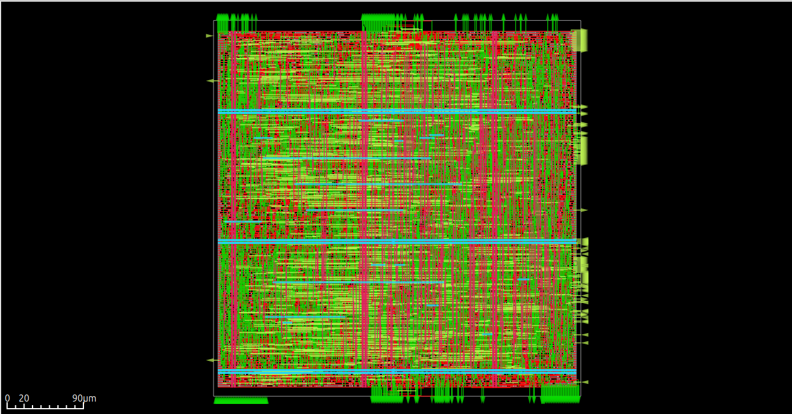

# PicoRV32 Physical Design — RTL to GDSII

Physical implementation of the open-source **PicoRV32 RISC-V processor** using LibreLane and the SkyWater SKY130A process design kit (PDK).

This project demonstrates an ASIC physical-design workflow from RTL synthesis through floorplanning, placement, clock-tree synthesis (CTS), routing, static timing analysis (STA), and physical verification.

## Final Layout



*Final layout visualization generated by the LibreLane physical-design flow.*

## Key Implementation Results

| Metric | Result |
|---|---:|
| Target clock period | 20 ns (50 MHz) |
| Core area | 176,307 µm² |
| Die area | 191,277 µm² |
| Standard-cell count | 12,423 |
| Sequential-cell count | 1,597 |
| Core utilization | 69.3% |
| Worst setup slack (WNS) | +0.741 ns |
| Worst hold slack (WNS) | +0.109 ns |
| Nominal power at TT corner | 12.24 mW |
| Final routing DRC errors | 0 |
| Magic DRC errors | 0 |
| KLayout DRC errors | 0 |
| LVS errors | 0 |

**Timing:** The final reports show positive worst setup and hold slack, with zero reported setup and hold violations across the evaluated timing corners.

**Physical verification:** The final reports show zero routing DRC errors, zero Magic DRC errors, zero KLayout DRC errors, and zero LVS errors.

**Power:** The reported nominal power is 12.24 mW at the TT corner. Power results depend on the activity assumptions, constraints, libraries, and implementation environment.

See [`results/final/reports/final_metrics.md`](results/final/reports/final_metrics.md) and the machine-readable metrics files for the recorded implementation data.


## Timing Analysis

The final implementation was evaluated against a **20 ns target clock period (50 MHz)**.

| Timing Metric | Reported Result |
|---|---:|
| Target clock period | 20 ns |
| Worst setup slack (WNS) | +0.741 ns |
| Worst hold slack (WNS) | +0.109 ns |
| Setup timing violations | 0 reported |
| Hold timing violations | 0 reported |

Both setup and hold worst slack are positive in the final reported results, indicating that the reported timing checks meet their constraints for the evaluated corners.

### Timing and Metrics Files

- [Final metrics summary](results/final/reports/final_metrics.md)
- [Machine-readable metrics (CSV)](results/final/metrics.csv)
- [Machine-readable metrics (JSON)](results/final/metrics.json)
- [Final timing constraints (SDC)](results/final/sdc/picorv32.sdc)

**Note:** The clock period is the target constraint, not a claim of measured maximum operating frequency. The reported slack values apply to the timing configuration and corners evaluated in this implementation run.


## Technology Stack

| Stage | Tool / Technology |
|---|---|
| RTL design | PicoRV32 RISC-V CPU |
| RTL-to-GDSII flow | LibreLane |
| Process design kit | SkyWater SKY130A |
| Logic synthesis | Yosys |
| Placement and routing | OpenROAD |
| Static timing analysis | OpenSTA |
| Design-rule checking | Magic and KLayout |
| Layout-versus-schematic verification | Netgen |

## Physical Design Flow

The implementation follows this general sequence:

1. RTL and flow configuration
2. Logic synthesis
3. Floorplanning and I/O placement
4. Global placement and optimization
5. Clock-tree synthesis (CTS)
6. Timing repair and placement refinement
7. Global and detailed routing
8. Antenna and routing checks
9. DRC and LVS verification
10. Final timing and implementation reporting

## Engineering Work

- Configured and ran the PicoRV32 RTL-to-GDSII flow using LibreLane and the SKY130A PDK, targeting a 20 ns clock period.
- Tuned floorplanning parameters, including `FP_CORE_UTIL` and `PL_TARGET_DENSITY_PCT`, and reviewed their impact on placement and implementation.
- Investigated clock-tree buffering, fanout, and capacitance constraints using OpenROAD timing and net reports.
- Examined timing-repair buffering and clock-network implementation to understand electrical-design constraints.
- Tracked routing DRC results across iterations, reducing reported violations from **132 in iteration 0 to zero in the final routing result**.
- Reviewed final setup and hold timing reports, along with physical-verification results, across the evaluated timing corners.

## Final Implementation Artifacts

The `results/final/` directory contains the selected deliverables from the final implementation run.

| Path | Description |
|---|---|
| [`gds/picorv32.gds`](results/final/gds/picorv32.gds) | Final GDSII layout |
| [`def/picorv32.def`](results/final/def/picorv32.def) | Final physical-design DEF |
| [`odb/picorv32.odb`](results/final/odb/picorv32.odb) | OpenROAD database |
| [`lef/picorv32.lef`](results/final/lef/picorv32.lef) | LEF representation |
| [`sdc/picorv32.sdc`](results/final/sdc/picorv32.sdc) | Timing constraints |
| [`render/picorv32.png`](results/final/render/picorv32.png) | Rendered layout preview |
| [`metrics.csv`](results/final/metrics.csv) | Implementation metrics in CSV format |
| [`metrics.json`](results/final/metrics.json) | Implementation metrics in JSON format |
| [`lib/`](results/final/lib/) | Liberty files for min, nominal, and max corners |
| [`reports/final_metrics.md`](results/final/reports/final_metrics.md) | Final metrics summary |

These artifacts support inspection and further analysis. Reproducing identical results requires a compatible tool environment, PDK revision, configuration, and constraints.

## Repository Structure

```text
.
├── README.md
├── PHYSICAL_DESIGN.md
├── config.json
├── src/
│   ├── picorv32.v
│   └── picorv32.core
├── results/
│   └── final/
│       ├── def/
│       ├── gds/
│       ├── lef/
│       ├── lib/
│       ├── metrics.csv
│       ├── metrics.json
│       ├── odb/
│       ├── render/
│       ├── reports/
│       └── sdc/
├── scripts/
├── tests/
├── firmware/
├── dhrystone/
├── picosoc/
├── Makefile
└── COPYING
```

## Reproducing the Flow

Install and configure LibreLane and the SKY130A PDK before running the flow.

From the repository root:

```bash
librelane config.json
```

The exact command and environment requirements can vary by LibreLane version and setup. The metrics in this repository describe the recorded implementation run and are not a guarantee of identical results in every environment.

## Future Work

Potential extensions include:

- Comparing floorplan utilization and placement-density settings.
- Evaluating tighter clock-period constraints.
- Studying clock-tree and buffering trade-offs.
- Comparing implementation changes using consistent area, timing, and power metrics.
- Exploring low-power physical-design techniques in a future project.

## License and Attribution

This project uses the open-source PicoRV32 RTL from [YosysHQ/PicoRV32](https://github.com/YosysHQ/picorv32).

Refer to [`COPYING`](COPYING) and the upstream repository for applicable license terms. Preserve the original copyright and license notices when redistributing upstream source files.

## Detailed Report

See [`PHYSICAL_DESIGN.md`](PHYSICAL_DESIGN.md) for additional implementation details, engineering notes, and physical-design results.
